 

---

## 👋 About Me

I am a recent **Bachelor of Computer Applications (BCA)** graduate from **Jamal Mohamed College**, based in **Tamil Nadu, India**. My focus is full stack web development. I am building a foundation in **Java**, **JavaScript**, **HTML**, and **CSS**, and I am currently learning the **MERN stack** under a mentor.

I am looking for **entry-level software developer** opportunities where I can keep growing, contribute to real product features, and learn from an experienced team.

---

## 🎓 Education

**Bachelor of Computer Applications (BCA)**
Jamal Mohamed College · CGPA: **8.52**

---

## 🛠 Technical Skills

**Programming Languages**
- Java (fundamentals)
- JavaScript (learning)

**Frontend Development**
- HTML
- CSS
- Responsive web design

**Backend / Full Stack**
- Currently learning the MERN stack
- Learning JavaScript concepts and preparing to move towards React

**Problem Solving**
- Data Structures and Algorithms using Java
- Practised problems on Arrays, Strings, Hashing, Matrix, Sorting, Two Pointers, Binary Search, and Stack

---

## 🌱 Currently Learning

- **MERN stack** (MongoDB, Express, React, Node.js), guided by a mentor
- **JavaScript** fundamentals, moving toward **React**
- **Data Structures & Algorithms** in Java

---

## 🚀 Projects

Projects below are taken from my public repositories.

| Project | Description | Technologies | Repository |
|---|---|---|---|
| **Deupload** | Frontend landing page for a decentralized cloud storage service | HTML, CSS, Bootstrap | [View repo](https://github.com/shifamugasheena26/Deupload-Home-Page) |
| **Bakery Website** | Bakery website layout | HTML, CSS | [View repo](https://github.com/shifamugasheena26/Bakery-webpage) |
| **Blog Page** | Blog page layout | HTML, CSS | [View repo](https://github.com/shifamugasheena26/Blog-Page) |
| **DOM Practice Projects** | Exercises on the DOM, callbacks, AJAX, and HTTP requests | JavaScript | [View repo](https://github.com/shifamugasheena26/DOM-PROJECT) |
| **DSA in Java** | Java implementations of sorting and array problems | Java | [View repo](https://github.com/shifamugasheena26/DSA-Java) |

**Learning repositories**
- [Full-Stack-Learning](https://github.com/shifamugasheena26/Full-Stack-Learning): HTML, CSS, and JavaScript practice
- [JavaScript-Fundamentals](https://github.com/shifamugasheena26/JavaScript-Fundamentals): JavaScript basics
- [java-basics](https://github.com/shifamugasheena26/java-basics): Java basics and string practice

---

## 🧮 DSA & Problem Solving

I practise data structures and algorithms in **Java**, focusing on:

- **Arrays & Strings**
- **Hashing** and **Matrix** problems
- **Sorting** and **Binary Search**
- **Two Pointers** and **Stack**

Code is in [DSA-Java](https://github.com/shifamugasheena26/DSA-Java). Sorting algorithms covered there include bubble, selection, and insertion sort.

---

## 📊 GitHub Activity

 

**[View the full contribution graph on GitHub →](https://github.com/shifamugasheena26)**

---

## 📫 Contact & Professional Links

---

