 

  
  
  

---

  

<!-- 

  <!-- PHOTO: Replace this file with your own photo -->
  <!-- 

 --> 

<!-- 

  I'm a BCA graduate and an aspiring Software Developer.
   
  Currently learning web development and improving my programming skills.
   
  I enjoy learning new technologies and building projects.

 -->

---

  

<!-- MY PROJECTS -->

  

---

  

  

---

  

 

  

---

  

- Strengthening JavaScript fundamentals.
- Practicing Java and Data Structures & Algorithms.
- Learning the MERN stack.
- Building hands-on projects.

---

  

---

---